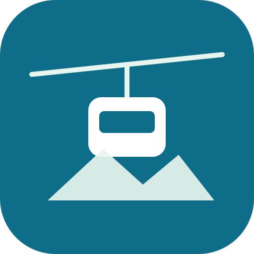
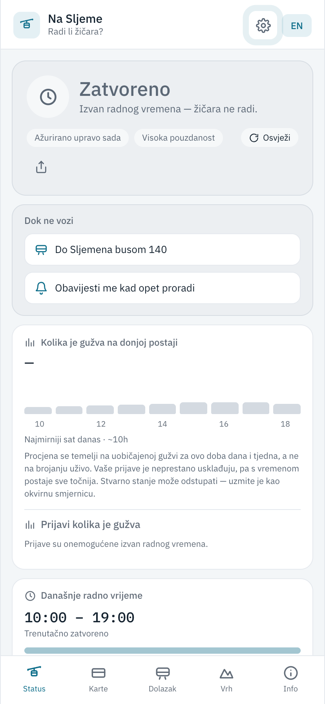
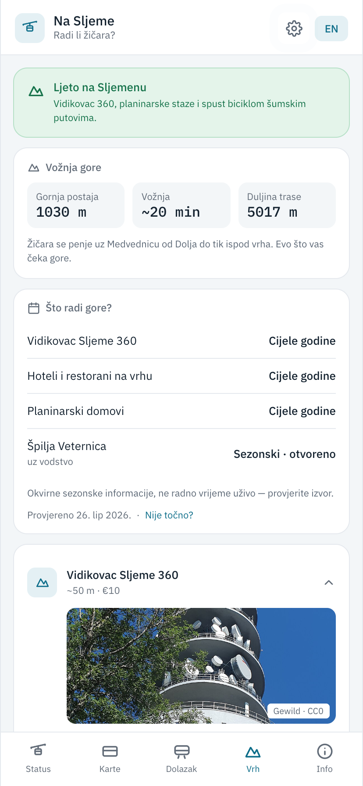
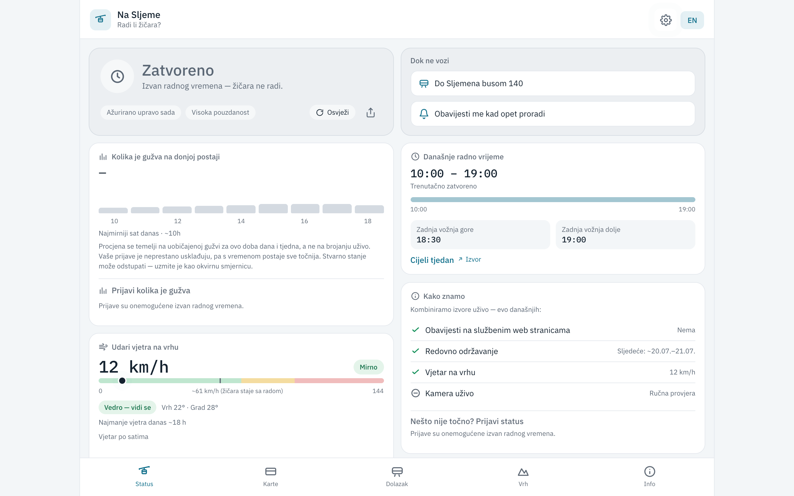

<p align="center">
  
</p>

<h1 align="center">Na Sljeme</h1>

<p align="center">
  Is the Sljeme Cable Car running right now? Open the app and you'll know.
</p>

<p align="center">
  <a href="https://nasljeme.net/"></a>
</p>

<p align="center">
  <a href="https://nasljeme.net/"><strong>nasljeme.net</strong></a>
</p>

---

## The story

The cable car up Sljeme is one of the best things about living in Zagreb. In about twenty minutes
it takes you from the end of the tram line to the top of Medvednica, 1030 m up. It also closes more
often than you'd think: when the wind picks up, for a couple of days of maintenance every month, for
a few weeks of servicing each autumn, and at hours that change with the season.

Too many of us have found that out at the bottom station. So I built the app I wanted to check
before leaving the house. It gives you one clear answer up front, and everything else you need for
the trip is a scroll away.

<p align="center">
  
  &nbsp;&nbsp;
  
</p>

## What it does

**It tells you if it's running.** The answer is running, running with limits, at risk because of
wind, stopped, or "we're not sure". Next to it you can see how confident the app is and what that
answer is based on. If the data is stale or missing, it says so instead of guessing.

**It helps you time the trip.** You get today's hours, a countdown to the last ride up (which comes
well before closing) and a heads-up when the last cabin down arrives after dark. Before you go, you
can check the wind on the summit against the speed at which the lift has actually stopped in the
past, see the calmest hour of the day, and find out whether you'll see anything from the top or be
standing in a cloud.

**It knows when it's busy.** A typical-day crowd curve for the lower station shows the quietest
hour and day and gives a rough idea of the wait. It gets better over time as riders report how
busy it is.

**It warns you about closures.** Planned maintenance comes straight from the official notices, and
you can add it to your calendar. When no date has been announced yet, the app shows an estimate and
labels it as one. There's also a simple track record of how many of the last 30 days the lift ran.

**It gets you there.** Tram 15 and buses 140, 233 and 227 each have a full route map. A live "on
the way" view shows the vehicle you'd actually catch, how many stops away it is and whether it's
running late, both on the way up and on the way back.

**It can ping you.** Opt-in alerts cover real closures, strong wind and tomorrow's maintenance.
There's also a "last cabin down soon" reminder for when you're still at the top, and a one-off "tell
me when it's running again". Alerts stay quiet at night and won't spam you.

There's more: ticket prices (free for Zagreb residents), a seasonal guide to the summit, what you
can bring along (bikes, dogs, skis, strollers), the live webcam, mountain safety numbers and an
FAQ. It's available in Croatian, English, German and Italian, you can install it on your home
screen, and it still works when your signal drops halfway up the mountain.

<p align="center">
  
</p>

## Put it on your site

If you run a site, a blog or a dashboard about Zagreb or hiking on Medvednica, you're welcome to
show the live status there.

The badge at the top of this page is one line of HTML. It comes in four languages and in light or
dark:

```html
<a href="https://nasljeme.net/"></a>
```

If you'd like real text that screen readers can announce and that updates itself, use the card:

```html
<iframe src="https://nasljeme.net/embed?lang=en" title="Sljeme Cable Car - live status (nasljeme.net)" width="320" height="150" style="border:0;border-radius:16px;max-width:100%" loading="lazy"></iframe>
```

There's also a [shields.io badge](https://img.shields.io/endpoint?url=https%3A%2F%2Fnasljeme.net%2Fapi%2Fv1%2Fshields.json%3Flang%3Den),
a small public JSON feed at `https://nasljeme.net/api/v1/status.json` for your own automations, and
phone home-screen widgets for iOS and Android. Setup instructions are at
[nasljeme.net/widgets](https://nasljeme.net/widgets).

## A few things I cared about

- **Being honest.** An app that's confidently wrong is worse than no app at all. Estimates are
  marked as estimates, and anything important links back to the official source.
- **Respecting your privacy.** There are no ads, no accounts and no tracking, and no data is sold.
  The only cookies remember your language and the tab you had open.
- **Working for everyone.** It's built to WCAG 2.1 AA and works with a keyboard and a screen reader.
- **Being fast.** It loads quickly on a patchy mountain connection, and dark mode follows your phone.

## How it's built

Na Sljeme is a SvelteKit and Svelte 5 app written in TypeScript and running on Cloudflare Workers.
It combines ZET's timetable and live transit feeds, official closure notices, Open-Meteo weather
for the summit and crowd data into a single answer. A scheduled worker keeps all of it up to date
without anyone having to touch it, and the whole thing runs on Cloudflare's free tier. The interface
uses its own small design system, set in IBM Plex.

## Disclaimer

This is an unofficial, independent project. It isn't affiliated with ZET, the cable car operator or
the City of Zagreb. Before you set off, check [zicarasljeme.hr](https://www.zicarasljeme.hr/) to be
sure.

---

<p align="center">
  Made in Zagreb by <a href="https://matijaculjak.com">Matija Culjak</a> ·
  <a href="mailto:hello@nasljeme.net">hello@nasljeme.net</a>
</p>
